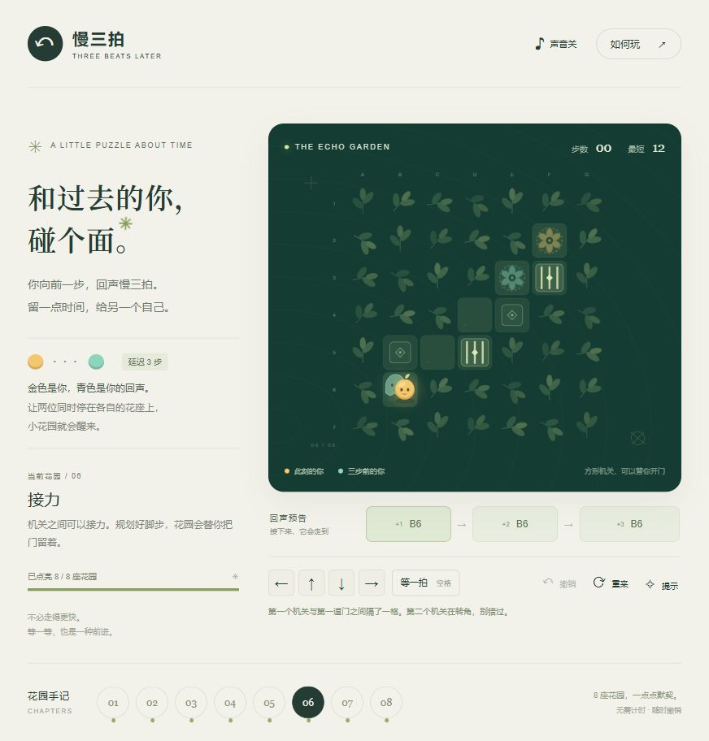

# 慢三拍 · Three Beats Later

一个关于移动、等待，以及与三步之前的自己合作的短篇解谜游戏。八座花园，方向移动与等待即可游玩；无倒计时，支持撤销和提示。

本仓库统一管理网页版、Android离线版、微信小游戏工程、资源与交付文档。

## 下载与状态

| 版本 | 成品入口 | 当前状态 |
| --- | --- | --- |
| 网页离线版 | [双击打开的HTML](releases/v1.0.0/web/three-beats-offline.html) | 已逐关浏览器试玩，已检查手机尺寸布局 |
| Android | [签名APK](releases/v1.0.0/android/three-beats-1.0.0.apk) | Android 8.0起；签名、对齐、包结构已检查，未真机试装 |
| 微信小游戏 | [可导入工程ZIP](releases/v1.0.0/wechat/three-beats-wechat-1.0.0.zip) | 22项逻辑及11项模拟宿主检查通过；AppID待填，未微信工具/真机验证 |

[全部发行文件与SHA-256](releases/v1.0.0/README.md) · [验证记录](docs/validation/README.md) · [变更记录](CHANGELOG.md)

现有[在线部署](https://three-beats-garden-7h2q.jocunddune20.chatgpt.site/)曾出现部分手机网络被托管平台拦截的情况，不保证所有网络可达。离线HTML与APK内置游戏资源；微信工程使用原生Canvas，不依赖该网页域名。



## 目录约定

```text
apps/
  web/                  网页源码、离线打包与规则测试
  android/              Android Manifest、Java、资源与构建脚本
  wechat/               可直接导入的微信小游戏工程
assets/
  game/                 单独导出的图标、分享图和音效
  previews/             实际预览截图
docs/
  design/               玩法与设计调研
  guides/               安装、导入和发布说明
  development/          构建与维护约定
  validation/           已验证结果及限制
releases/v1.0.0/        按平台归档的成品、源码包与校验清单
tools/                  跨平台检查、打包与工具链准备
```

安卓签名私钥、密码、SDK、旧Sites Git历史、登录凭据及本地调试缓存均不属于仓库。已交付APK的原签名材料只在所有者的本机另行保管；更新同一应用需要原签名。

## 开发与运行

### Web

需要 Node.js 22+，没有运行时npm依赖。从仓库任意位置运行：

```sh
node apps/web/preview.mjs
node apps/web/test-engine.js
node apps/web/build-offline.mjs
```

预览默认仅监听本机 `http://127.0.0.1:4173`。网页可编辑源码位于 `apps/web/src/`。

### 微信小游戏

将 `apps/wechat/` 导入微信开发者工具，填写账号后台的真实AppID，项目类型选择小游戏。代码包内包含全部资源，无npm运行依赖，无需配置服务器请求域名。

```sh
node apps/wechat/tools/check-project.cjs
node apps/wechat/tests/logic.test.js
node apps/wechat/tests/runtime.test.js
node apps/wechat/tools/serve-preview.cjs
```

浏览器适配预览不能代替微信真机验证。[完整导入说明](docs/guides/wechat-import.md) · [真机测试清单](apps/wechat/docs/真机测试清单.md) · [隐私说明草稿](apps/wechat/docs/隐私保护指引草稿.md)

### Android

游戏资源已内置于 `apps/android/assets/`，安装后无需网页网络连接。自行编译需要Java、Android SDK Build Tools 35和Platform 35；当前构建脚本面向Windows。原签名材料不随仓库分发。

[构建说明](docs/development/android-build.md) · [手机安装说明](docs/guides/android-install.md)

## 统一检查与打包

```sh
node tools/check-all.cjs
python tools/verify-repository.py
python tools/package-deliverables.py
```

检查无需微信账号、Android SDK或签名密钥。CI只运行这些非账号检查，不自动上传微信、不签名APK、不部署网页。

游戏运行不需要第三方JavaScript包；安卓构建、可选浏览器预览重新打包和素材重新生成各有工具依赖，详见对应说明。

## 许可与发布

仓库所有者尚未选择开源许可证；本仓库不附带MIT等开源授权。参见[许可说明](docs/licensing.md)。正式发布微信小游戏仍需由账号所有者按后台要求完成主体信息、隐私指引、备案、适龄提示及所选路线的资质与审核。
